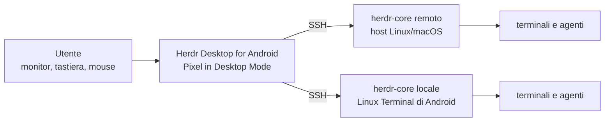

# Context and main flows

- L'app è un client: non esegue terminali. Ogni macchina configurata ha un core che tiene vivi terminali e agenti anche quando l'app è chiusa.
- L'app apre una connessione SSH per macchina e, su di essa, parla con l'API del core (dettagli in `integrations.md`).

## Flussi principali

1. **Aggiungere una macchina:** l'utente inserisce host, porta e utente, sceglie una chiave del Keystore o una password, conferma l'impronta della host key; l'app si collega e verifica la versione del core.
2. **Core assente o incompatibile:** l'app lo segnala e, dopo conferma, lo installa o aggiorna sulla macchina, poi si collega.
3. **Lavorare:** l'app mostra spazi e tab dal core; l'utente divide le tab in pane, ogni pane è collegato a un terminale del core e ne trasmette input e dimensioni.
4. **Seguire gli agenti:** l'app riceve dal core gli stati degli agenti e li mostra nella sidebar; un agente senza pane si apre in peek.
5. **Chiudere e riaprire:** chiudere l'app non ferma i terminali; riaprendola, l'app ricostruisce spazi, tab e pane dallo stato del core.
